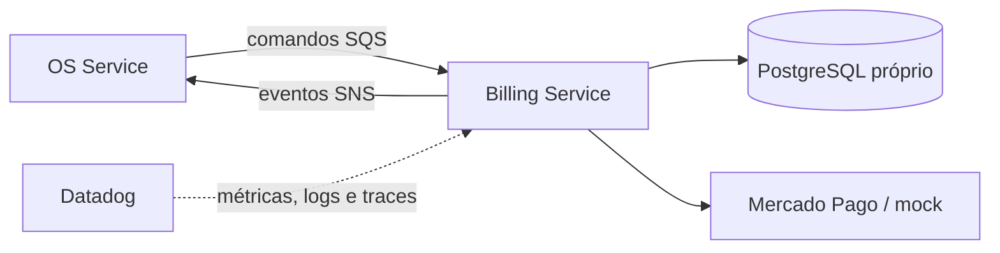

# Oficina Billing Service

Microsserviço responsável por orçamento, aprovação e pagamento das ordens de serviço, incluindo integração isolada com Mercado Pago e modo mock acadêmico.

## Tecnologias

Node.js 22, TypeScript, Docker, Kubernetes, Terraform, GitHub Actions, SonarCloud e Datadog. O banco definido para o serviço é PostgreSQL e a integração assíncrona usará SNS/SQS.

## Executar localmente

```bash
npm ci
npm run test:coverage
npm run dev
```

O health check estará em `GET http://localhost:3000/health`.

## Build e deploy

```bash
npm run build
docker build -t oficina-billing-service .
kubectl apply -f k8s/
terraform -chdir=infra init -backend=false
terraform -chdir=infra validate
```

O CI executa tipos, testes com cobertura mínima de 80%, build, auditoria crítica e build da imagem. Após CI bem-sucedida em `homolog` ou `main`, o CD publica uma imagem imutável no GHCR e faz rollout no EKS. `homolog` usa o GitHub Environment `hml`; `main` usa `prod`, que deve permanecer protegido por aprovação. O acionamento manual foi mantido como contingência.

Variáveis dos Environments: `AWS_REGION`, `EKS_CLUSTER_NAME` e, opcionalmente, `PAYMENT_PROVIDER`. Segredos: `AWS_ACCESS_KEY_ID`, `AWS_SECRET_ACCESS_KEY`, `AWS_SESSION_TOKEN`, `BILLING_DATABASE_URL`, `MERCADO_PAGO_ACCESS_TOKEN` e `MERCADO_PAGO_WEBHOOK_SECRET`. O workflow materializa o Secret Kubernetes em tempo de deploy; nenhum valor sensível é versionado.

No AWS Academy Learner Lab, o cluster não disponibiliza OIDC/IRSA nem EKS Pod Identity. Por essa limitação acadêmica, as credenciais temporárias da sessão também são injetadas no pod via `Secret` para consumo de SQS/SNS e expiram junto com o laboratório. Em uma conta permanente, a decisão-alvo é substituir essa compatibilidade por IRSA/Pod Identity com privilégio mínimo, sem credenciais estáticas no workload.

Os manifestos incluem Deployment com rollout sem indisponibilidade, probes de inicialização/prontidão/vida, limites de recursos, contexto restritivo, HPA por CPU e memória, Service, ConfigMap e PodDisruptionBudget.

## Observabilidade

O serviço envia traces APM, runtime metrics e métricas DogStatsD ao Agent do nó. Requisições e comandos da Saga produzem logs JSON com `correlationId`, `sagaId`, `eventId` e `ordemServicoId`; campos sensíveis são redigidos. Principais métricas: `oficina.http.*`, `oficina.saga.messages.*` e `oficina.saga.message.duration_ms`. Consulte a [estratégia integrada de observabilidade](https://github.com/maypinheiro/oficina-api/blob/develop/docs/fase4/fase10-observabilidade-distribuida.md).

## Arquitetura do serviço



O serviço nunca acessa o banco do OS Service ou do Execution Service.

## API e documentação

- [Arquitetura e limites](docs/architecture.md)
- [Contratos de mensageria v1](docs/contracts.md)
- [Visão integrada da mensageria](https://github.com/maypinheiro/oficina-api/blob/develop/docs/fase4/fase3-mensageria-basica.md)
- [Saga orquestrada e compensações](https://github.com/maypinheiro/oficina-api/blob/develop/docs/fase4/fase4-saga-implementada.md)
- [Integração Mercado Pago e webhook seguro](https://github.com/maypinheiro/oficina-api/blob/develop/docs/fase4/fase5-mercado-pago.md)
- [Migração e isolamento dos dados](docs/data-migration.md)
- Webhook Mercado Pago: `POST /webhooks/mercado-pago?data.id={paymentId}` com validação `x-signature`.
- [Arquitetura geral e Saga no OS Service](https://github.com/maypinheiro/oficina-api/tree/develop/docs/fase4)

## Configuração de pagamento

Use `PAYMENT_PROVIDER=mock` para desenvolvimento seguro. Para o Sandbox real, use `PAYMENT_PROVIDER=mercado-pago` e injete `MERCADO_PAGO_ACCESS_TOKEN`, `MERCADO_PAGO_WEBHOOK_SECRET` e `MERCADO_PAGO_PAYER_EMAIL` por segredo; credenciais nunca devem ser commitadas.
