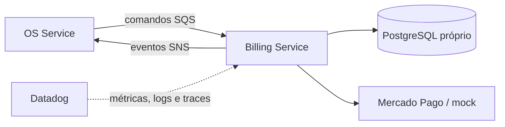

# Oficina Billing Service

Microsserviço responsável por orçamento, aprovação e pagamento das ordens de serviço. A Fase 1 entrega o repositório independente e sua base operacional; regras de negócio, Mercado Pago, persistência e mensageria serão implementados nas fases seguintes.

## Tecnologias

Node.js 22, TypeScript, Docker, Kubernetes, Terraform, GitHub Actions, SonarCloud e Datadog. O banco definido para o serviço é PostgreSQL e a integração assíncrona usará SNS/SQS.

## Executar localmente

```bash
npm ci
npm run test:coverage
npm run dev
```

O health check estará em `GET http://localhost:3000/health`.

## Build e deploy

```bash
npm run build
docker build -t oficina-billing-service .
kubectl apply -f k8s/
terraform -chdir=infra init -backend=false
terraform -chdir=infra validate
```

O CI executa tipos, testes com cobertura mínima de 80%, build, auditoria crítica e build da imagem. O CD desta fase valida Kubernetes e Terraform; a publicação no ECR/EKS será habilitada quando os ambientes e secrets forem provisionados.

## Arquitetura do serviço



O serviço nunca acessa o banco do OS Service ou do Execution Service.

## API e documentação

- [Arquitetura e limites](docs/architecture.md)
- [Contratos planejados](docs/contracts.md)
- [Migração e isolamento dos dados](docs/data-migration.md)
- Swagger/OpenAPI: será publicado junto aos endpoints de orçamento e pagamento; nesta fase somente `/health` existe.
- [Arquitetura geral e Saga no OS Service](https://github.com/maypinheiro/oficina-api/tree/develop/docs/fase4)

## Estado da Fase 1

O schema PostgreSQL próprio, a migration inicial e os scripts idempotentes de migração/reconciliação estão versionados. Integração de pagamento, filas e Saga permanecem nas próximas fases.
