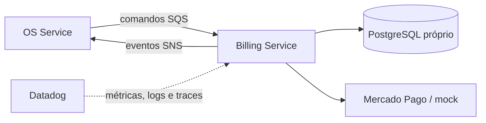

# Oficina Billing Service

Microsserviço responsável por orçamento, aprovação e pagamento das ordens de serviço, incluindo integração isolada com Mercado Pago e modo mock acadêmico.

## Tecnologias

Node.js 22, TypeScript, Docker, Kubernetes, Terraform, GitHub Actions, SonarCloud e Datadog. O banco definido para o serviço é PostgreSQL e a integração assíncrona usará SNS/SQS.

## Executar localmente

```bash
npm ci
npm run test:coverage
npm run dev
```

O health check estará em `GET http://localhost:3000/health`.

## Build e deploy

```bash
npm run build
docker build -t oficina-billing-service .
kubectl apply -f k8s/
terraform -chdir=infra init -backend=false
terraform -chdir=infra validate
```

O CI executa tipos, testes com cobertura mínima de 80%, build, auditoria crítica e build da imagem. O CD desta fase valida Kubernetes e Terraform; a publicação no ECR/EKS será habilitada quando os ambientes e secrets forem provisionados.

## Arquitetura do serviço



O serviço nunca acessa o banco do OS Service ou do Execution Service.

## API e documentação

- [Arquitetura e limites](docs/architecture.md)
- [Contratos de mensageria v1](docs/contracts.md)
- [Visão integrada da mensageria](https://github.com/maypinheiro/oficina-api/blob/develop/docs/fase4/fase3-mensageria-basica.md)
- [Saga orquestrada e compensações](https://github.com/maypinheiro/oficina-api/blob/develop/docs/fase4/fase4-saga-implementada.md)
- [Integração Mercado Pago e webhook seguro](https://github.com/maypinheiro/oficina-api/blob/develop/docs/fase4/fase5-mercado-pago.md)
- [Migração e isolamento dos dados](docs/data-migration.md)
- Webhook Mercado Pago: `POST /webhooks/mercado-pago?data.id={paymentId}` com validação `x-signature`.
- [Arquitetura geral e Saga no OS Service](https://github.com/maypinheiro/oficina-api/tree/develop/docs/fase4)

## Estado da Fase 1

Use `PAYMENT_PROVIDER=mock` para desenvolvimento seguro. Para o Sandbox real, use `PAYMENT_PROVIDER=mercado-pago` e injete `MERCADO_PAGO_ACCESS_TOKEN`, `MERCADO_PAGO_WEBHOOK_SECRET` e `MERCADO_PAGO_PAYER_EMAIL` por segredo; credenciais nunca devem ser commitadas.
