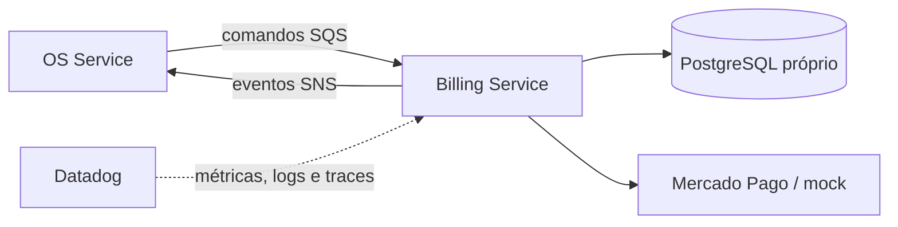

# Oficina Billing Service

Microsserviço responsável por orçamento, aprovação e pagamento das ordens de serviço, incluindo integração isolada com Mercado Pago e modo mock acadêmico.

A decisão do cliente é recebida por `POST /budgets/{orderId}/decision`, com `{"decision":"approve"}` ou `{"decision":"reject"}`. O Billing Service persiste a decisão no seu próprio PostgreSQL e publica `QuoteApproved` ou `QuoteRejected` no tópico de eventos; o OS Service consome o evento e continua ou compensa a Saga.

## Tecnologias

Node.js 22, TypeScript, Docker, Kubernetes, Terraform, GitHub Actions, SonarCloud e Datadog. O banco definido para o serviço é PostgreSQL e a integração assíncrona usará SNS/SQS.

## Executar localmente

```bash
npm ci
npm run test:coverage
npm run dev
```

O health check estará em `GET http://localhost:3000/health`.

## Build e deploy

```bash
npm run build
docker build -t oficina-billing-service .
kubectl apply -f k8s/
terraform -chdir=infra init -backend=false
terraform -chdir=infra validate
```

O CI executa tipos, testes com cobertura mínima de 80%, build, auditoria crítica e build da imagem. Após CI bem-sucedida em `homolog` ou `main`, o CD publica uma imagem imutável no GHCR e faz rollout no EKS. `homolog` usa o GitHub Environment `hml`; `main` usa `prod`, que deve permanecer protegido por aprovação. O acionamento manual foi mantido como contingência.

Variáveis dos Environments: `AWS_REGION`, `EKS_CLUSTER_NAME` e, opcionalmente, `PAYMENT_PROVIDER`. Segredos: `AWS_ACCESS_KEY_ID`, `AWS_SECRET_ACCESS_KEY`, `AWS_SESSION_TOKEN`, `BILLING_DATABASE_URL`, `MERCADO_PAGO_ACCESS_TOKEN` e `MERCADO_PAGO_WEBHOOK_SECRET`. O workflow materializa o Secret Kubernetes em tempo de deploy; nenhum valor sensível é versionado.

No AWS Academy Learner Lab, o cluster não disponibiliza OIDC/IRSA nem EKS Pod Identity. Por essa limitação acadêmica, as credenciais temporárias da sessão também são injetadas no pod via `Secret` para consumo de SQS/SNS e expiram junto com o laboratório. Em uma conta permanente, a decisão-alvo é substituir essa compatibilidade por IRSA/Pod Identity com privilégio mínimo, sem credenciais estáticas no workload.

Os manifestos incluem Deployment com rollout sem indisponibilidade, probes de inicialização/prontidão/vida, limites de recursos, contexto restritivo, HPA por CPU e memória, Service, ConfigMap e PodDisruptionBudget.

## Observabilidade

O serviço envia traces APM, runtime metrics e métricas DogStatsD ao Agent do nó. Requisições e comandos da Saga produzem logs JSON com `correlationId`, `sagaId`, `eventId` e `ordemServicoId`; campos sensíveis são redigidos. Principais métricas: `oficina.http.*`, `oficina.saga.messages.*` e `oficina.saga.message.duration_ms`. Consulte a [estratégia integrada de observabilidade](https://github.com/maypinheiro/oficina-api/blob/main/docs/fase4/fase10-observabilidade-distribuida.md).

## Arquitetura do serviço



O serviço nunca acessa o banco do OS Service ou do Execution Service.

## API e documentação

| Documento | O que comprova |
|---|---|
| [OpenAPI 3.0](docs/openapi.yaml) | rotas HTTP, payloads e respostas do Billing |
| [Arquitetura do serviço](docs/architecture.md) | componentes, banco SQL, ER, fluxos, segurança, Kubernetes e rastreabilidade |
| [Decisões arquiteturais](docs/decisions.md) | PostgreSQL, Outbox/Inbox, Mercado Pago, REST/mensageria e deploy independente |
| [Contratos de mensageria v1](docs/contracts.md) | comandos, eventos, envelope e idempotência |
| [Migração e isolamento dos dados](docs/data-migration.md) | cutover do legado, reconciliação e revogação do acesso antigo |
| [Arquitetura geral da Fase 4](https://github.com/maypinheiro/oficina-api/blob/main/docs/fase4/arquitetura-alvo.md) | visão dos três microsserviços, bancos e comunicação |
| [Saga orquestrada e compensações](https://github.com/maypinheiro/oficina-api/blob/main/docs/fase4/saga-orquestrada.md) | caminho feliz, máquina de estados e rollback de negócio |
| [Integração Mercado Pago](https://github.com/maypinheiro/oficina-api/blob/main/docs/fase4/fase5-mercado-pago.md) | adapter, idempotência, webhook e modo acadêmico |
| [Matriz de conformidade](https://github.com/maypinheiro/oficina-api/blob/main/docs/fase4/matriz-conformidade.md) | requisito oficial → implementação → evidência |
| [Catálogo de evidências](https://github.com/maypinheiro/oficina-api/blob/main/docs/fase4/catalogo-evidencias.md) | testes, pipelines, OS/Sagas executadas e Datadog |
| [RFCs e ADRs globais](https://github.com/maypinheiro/oficina-api/tree/main/docs/fase4) | justificativa da divisão, Saga, SNS/SQS, Outbox e persistência poliglota |
- Webhook Mercado Pago: `POST /webhooks/mercado-pago?data.id={paymentId}` com validação `x-signature`.
- O webhook persiste `PaymentConfirmed`/`PaymentFailed` na outbox transacional. Um publicador com claim otimista, retentativa exponencial e limite de cinco tentativas entrega os eventos ao SNS sem duplicação concorrente entre réplicas.
- Em HML, `PAYMENT_PROVIDER=mock` e `PAYMENT_SIMULATION_ENABLED=true` habilitam `POST /payments/{orderId}/simulate` para demonstrar aprovação ou rejeição pelo mesmo serviço de webhook. A rota fica oculta quando a flag está desabilitada e nunca deve ser habilitada em produção.
- [Arquitetura geral e Saga no OS Service](https://github.com/maypinheiro/oficina-api/tree/main/docs/fase4)

O arquivo OpenAPI pode ser importado no Swagger Editor, Swagger UI, Insomnia ou Postman. A API pública continua centralizada no OS Service/API Gateway; Billing é acessado internamente pelo cluster e por mensageria, exceto pelo webhook do provedor.

## Rastreabilidade rápida dos requisitos

| Requisito | Atendimento |
|---|---|
| Microsserviço independente | repositório, imagem, Terraform, banco, manifests e CI/CD próprios |
| Banco relacional próprio | RDS PostgreSQL privado em `infra/database.tf` |
| Orçamento e aprovação | casos de uso HTTP/Saga e eventos `QuoteCreated`, `QuoteApproved` e `QuoteRejected` |
| Pagamento | porta `PaymentGateway`, adapter Mercado Pago, mock HML e webhook assinado |
| Comunicação assíncrona | fila SQS exclusiva, tópico SNS, retry e DLQ |
| Saga e rollback | comandos compensatórios de orçamento, aprovação, cobrança e estorno |
| Qualidade | testes unitários, gate de cobertura de 80%, build e análise SonarCloud da organização |
| Kubernetes | Deployment, Service, HPA, PDB, probes e security context |
| Observabilidade | APM, logs JSON e métricas correlacionadas no Datadog |

## Configuração de pagamento

Use `PAYMENT_PROVIDER=mock` para desenvolvimento seguro. Para o Sandbox real, use `PAYMENT_PROVIDER=mercado-pago` e injete `MERCADO_PAGO_ACCESS_TOKEN`, `MERCADO_PAGO_WEBHOOK_SECRET` e `MERCADO_PAGO_PAYER_EMAIL` por segredo; credenciais nunca devem ser commitadas. A simulação controlada exige explicitamente `PAYMENT_SIMULATION_ENABLED=true` e é exclusiva de homologação acadêmica.
