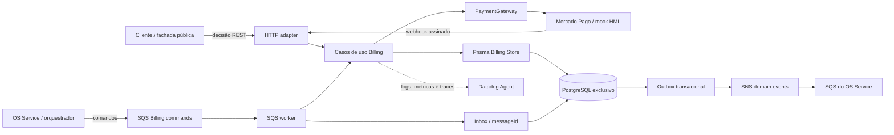
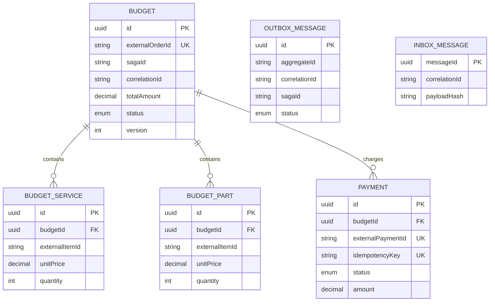
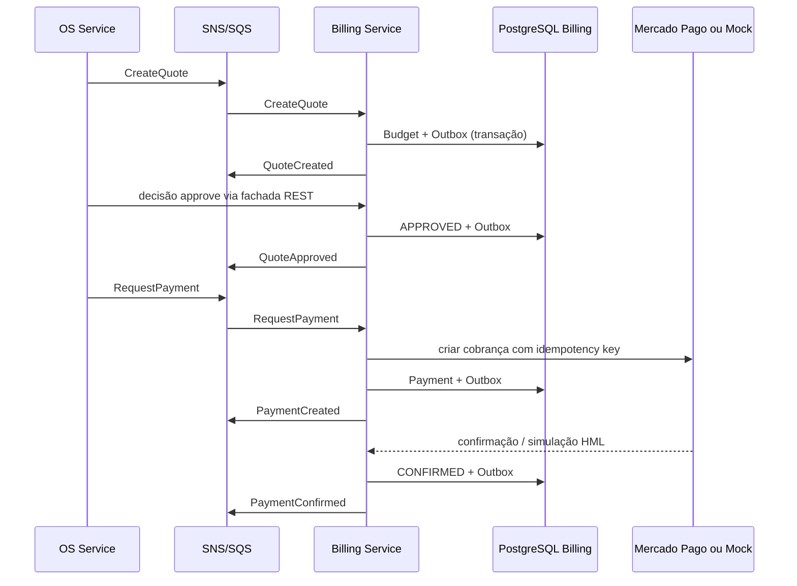

# Arquitetura do Billing Service

## Objetivo e limite de domínio

O Billing Service é o microsserviço responsável por orçamento, decisão do
cliente, cobrança e pagamento. Ele é o único componente autorizado a alterar
orçamentos e pagamentos e nunca acessa os bancos do OS Service ou do Execution
Service.

O serviço participa da Saga orquestrada pelo OS Service. Recebe comandos por
SQS, confirma cada transação somente no seu PostgreSQL e publica o resultado no
tópico SNS. A decisão sobre a próxima etapa da jornada permanece no OS Service.

## Visão de componentes

## Portas e adaptadores

| Camada | Implementação | Responsabilidade |
|---|---|---|
| Entrada HTTP | `src/app.ts` | health, decisão do orçamento, webhook e simulação controlada de HML |
| Entrada assíncrona | `src/messaging/sqs-worker.ts` | long polling, processamento e confirmação de mensagens SQS |
| Aplicação | `src/budget`, `src/payment`, `src/saga` | regras de orçamento, pagamento e comandos da Saga |
| Persistência | `src/saga/prisma-billing-store.ts` | transações locais no banco Billing |
| Mensageria | `src/messaging` | envelope, inbox, outbox, SNS/SQS e idempotência |
| Pagamento | `src/payment/*gateway.ts` | porta para Mercado Pago e implementação mock acadêmica |
| Observabilidade | `src/observability` | logs JSON, APM, métricas HTTP e métricas da Saga |

## Persistência relacional própria

O banco é um Amazon RDS PostgreSQL privado provisionado pelo Terraform deste
repositório. O segredo `BILLING_DATABASE_URL` é independente da conexão do OS
Service. TLS é obrigatório e a porta 5432 aceita somente os Security Groups
declarados.

`Budget`, itens e `Payment` preservam integridade referencial e transações, o
que justifica SQL. `InboxMessage` deduplica consumo e `OutboxMessage` garante
que estado e intenção de publicação sejam confirmados na mesma transação local.

## Comunicação e consistência

- REST é usado apenas nas bordas: decisão do orçamento, webhook e simulação HML;
- comandos da Saga chegam pela fila exclusiva do Billing;
- eventos são publicados em SNS e entregues à fila do orquestrador;
- a entrega é *at-least-once*, portanto handlers são idempotentes;
- `messageId` evita efeito duplicado e `payloadHash` detecta reuso inconsistente;
- `correlationId`, `sagaId` e `causationId` preservam a cadeia causal;
- falhas transitórias voltam à fila; após cinco recebimentos seguem para DLQ;
- o publicador da outbox usa claim otimista, backoff e limite de tentativas.

## Participação na Saga

### Caminho normal

### Compensações

O serviço implementa `CancelQuote`, `CancelQuoteApproval`, `CancelPayment` e
`RefundPayment`. Cada comando altera somente o banco Billing e responde com um
evento de conclusão. Uma repetição do mesmo comando não deve criar pagamento,
cancelamento ou estorno adicional.

## Kubernetes, segurança e disponibilidade

- namespace `oficina-billing`, Deployment com duas réplicas e RollingUpdate;
- HPA por CPU/memória e PodDisruptionBudget;
- startup, readiness e liveness em `/health`;
- processo não-root, `seccompProfile: RuntimeDefault`, capabilities removidas,
  filesystem somente leitura e ServiceAccount token desabilitado;
- configuração não sensível em ConfigMap e segredos criados pelo CD;
- imagem imutável identificada pelo SHA validado no CI;
- migrations Prisma executadas antes do container principal iniciar.

No AWS Academy Learner Lab, a sessão STS temporária é injetada no pod porque o
laboratório atual não disponibiliza IRSA/Pod Identity. A arquitetura de produção
recomendada usa identidade de workload e privilégio mínimo.

## Observabilidade

Logs estruturados e spans carregam `service`, `env`, `version`, `correlationId`,
`sagaId`, `eventId` e `ordemServicoId`. DogStatsD publica volume, duplicações,
falhas e duração do processamento. O dashboard distribuído correlaciona Billing,
OS e Execution sem registrar token, CPF ou credenciais de pagamento.

## Rastreabilidade

| Requisito da Fase 4 | Evidência neste repositório |
|---|---|
| Banco próprio SQL | `infra/database.tf`, `prisma/schema.prisma` |
| Infraestrutura própria | `infra/`, `k8s/` e `.github/workflows/cd.yml` |
| Orçamento e aprovação | `src/budget` e `src/saga/billing-command-handler.ts` |
| Pagamento/Mercado Pago | `src/payment/mercado-pago-gateway.ts` e webhook |
| Mensageria | `src/messaging`, fila/DLQ e contratos |
| Compensação | comandos `CancelQuote*`, `CancelPayment` e `RefundPayment` |
| Idempotência | inbox, outbox e `idempotencyKey` do pagamento |
| Cobertura mínima | `npm run test:coverage` com gate de 80% no CI |
| Kubernetes | Deployment, Service, HPA e PDB em `k8s/` |
| Observabilidade | `src/observability` e tags Datadog no Deployment |

As decisões e alternativas estão em [decisions.md](decisions.md), os contratos
em [contracts.md](contracts.md) e a visão geral da Saga no
[OS Service](https://github.com/maypinheiro/oficina-api/tree/main/docs/fase4).
